# SIGRE · Diagrama de secuencia: SOS en vivo

Flujo completo de una emergencia: el ciudadano pide ayuda, entra a la cola,
un operador la toma (asignación atómica), hablan por videollamada WebRTC,
el operador sigue su ubicación en el mapa y la atención se cierra.

```mermaid
%%{init: {"theme": "default", "sequence": {"mirrorActors": false, "wrap": true, "actorFontSize": 16, "messageFontSize": 15, "noteFontSize": 14}}}%%

sequenceDiagram
    autonumber
    actor C as Ciudadano (navegador)
    participant S as Servidor Flask-SocketIO
    participant BD as PostgreSQL
    actor O as Operador (panel admin)
    participant T as STUN / TURN (Metered)

    Note over C,O: Ambos se conectan a Socket.IO con su token JWT. El servidor lee el rol desde la base y une a las autoridades a la sala "operadores".

    rect rgb(255, 240, 240)
    Note over C,O: 1. Pedir SOS y entrar a la cola
    C->>C: Pide permiso y lee la ubicación GPS
    C->>S: sos:crear (lat, lng, precisión)
    S->>BD: INSERT sesiones_sos (estado en_espera)
    S->>BD: INSERT ubicaciones_sos (primer punto)
    S->>BD: Posición en la cola
    BD-->>S: posición
    S-->>C: sesión y posición en la cola
    S->>O: sos:nueva (a la sala operadores) y aviso push
    O->>S: sos:cola
    S-->>O: lista de emergencias en espera
    end

    alt El ciudadano cancela mientras espera
        C->>S: sos:cancelar
        S->>BD: UPDATE estado cancelada
        S->>O: sos:retirada (cancelada)
    end

    rect rgb(240, 248, 255)
    Note over C,O: 2. Asignación atómica
    O->>S: sos:aceptar (sesión)
    S->>BD: UPDATE en_curso, operador_id WHERE estado en_espera AND operador_id IS NULL
    alt Otro operador la tomó primero
        BD-->>S: 0 filas
        S-->>O: error: ya fue tomada por otro operador
    else Este operador la toma
        BD-->>S: 1 fila (ciudadano, hora de atención)
        S->>BD: Contacto del ciudadano y última ubicación
        S-->>O: contacto, hora de inicio y ubicación
        S->>C: sos:aceptada (hora de inicio)
        S->>O: sos:retirada a los demás operadores (tomada)
    end
    end

    rect rgb(240, 255, 244)
    Note over C,O: 3. Videollamada WebRTC (señalización por el servidor)
    C->>S: GET /api/sos/ice
    S-->>C: servidores STUN y TURN
    C->>C: Cámara y micrófono, crea la offer
    C->>S: webrtc:offer (SDP)
    S->>BD: ¿Participa en esta emergencia en curso?
    S->>O: webrtc:offer
    O->>S: GET /api/sos/ice
    S-->>O: servidores STUN y TURN
    O->>O: Cámara y micrófono, crea la answer
    O->>S: webrtc:answer (SDP)
    S->>C: webrtc:answer
    loop Hasta encontrar un camino de red
        C->>S: webrtc:ice (candidato)
        S->>O: webrtc:ice
        O->>S: webrtc:ice (candidato)
        S->>C: webrtc:ice
    end
    C->>T: Prueba conexión directa (STUN) o por relé (TURN)
    O->>T: Prueba conexión directa (STUN) o por relé (TURN)
    C-->O: Audio y video entre los dos (no pasan por el servidor de SIGRE)
    end

    rect rgb(255, 250, 235)
    Note over C,O: 4. Ubicación en vivo
    loop Cada 5 segundos mientras la emergencia está abierta
        C->>S: sos:ubicacion (lat, lng, precisión)
        S->>BD: INSERT ubicaciones_sos (la seguridad por filas exige que sea propia y abierta)
        S->>O: sos:ubicacion
        O->>O: Mueve el marcador y dibuja el recorrido en el mapa
    end
    end

    opt Alguien recarga o pierde la conexión
        O->>S: sos:retomar
        S-->>O: emergencia en curso, contacto y última ubicación
        O->>S: webrtc:pedir_oferta
        S->>C: webrtc:pedir_oferta
        C->>S: webrtc:offer (nueva) y se repite la negociación
    end

    rect rgb(245, 245, 245)
    Note over C,O: 5. Cierre
    alt El operador finaliza
        O->>S: sos:finalizar
    else El ciudadano cuelga
        C->>S: sos:finalizar
    end
    S->>BD: UPDATE estado finalizada, hora y motivo de cierre
    BD-->>S: hora de atención y de cierre
    S->>C: sos:finalizada (duración)
    S->>O: sos:finalizada (duración)
    S->>S: Cierra la sala de la emergencia
    C->>C: Apaga cámara, cronómetro y envío de ubicación
    O->>O: Apaga cámara, limpia el mapa y vuelve a la cola
    end
```

## Cómo leerlo

- **Flecha continua (→):** mensaje que se envía.
- **Flecha punteada (⇢):** respuesta.
- **alt / else:** caminos que se excluyen (por ejemplo, otro operador la tomó primero).
- **loop:** se repite (candidatos ICE, ubicación cada 5 s).
- **opt:** solo pasa a veces (reconexión).
- El **audio y video** viajan directo entre los dos navegadores (o por el relé TURN); el servidor de SIGRE solo pasa la señalización.
